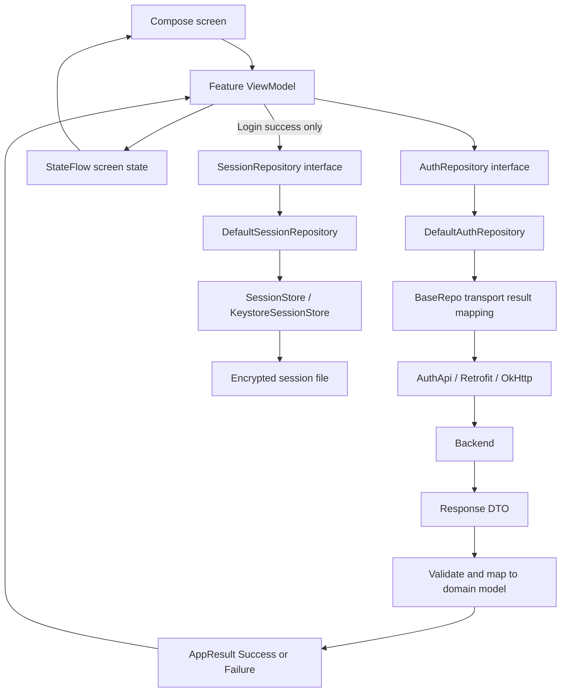
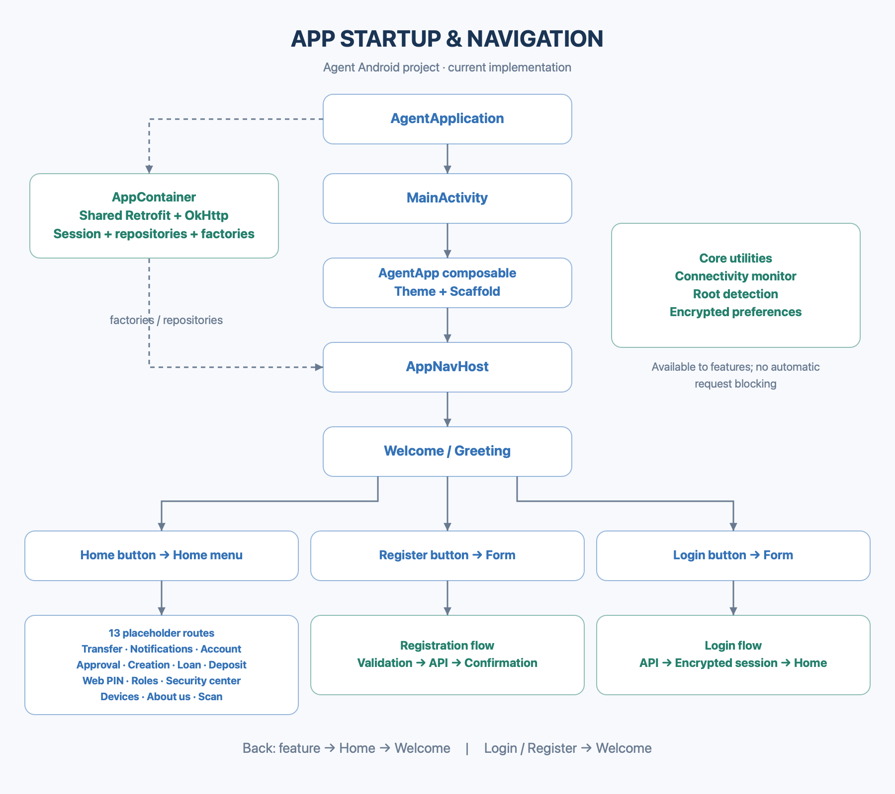
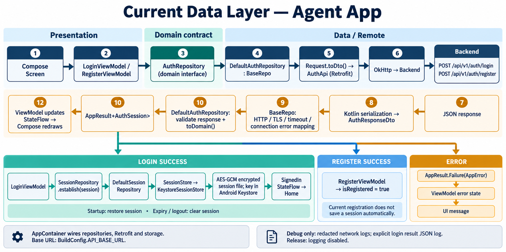
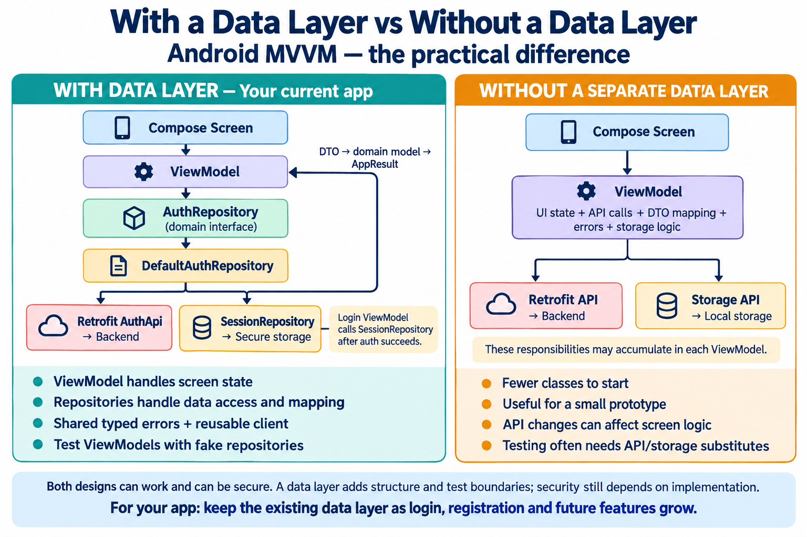
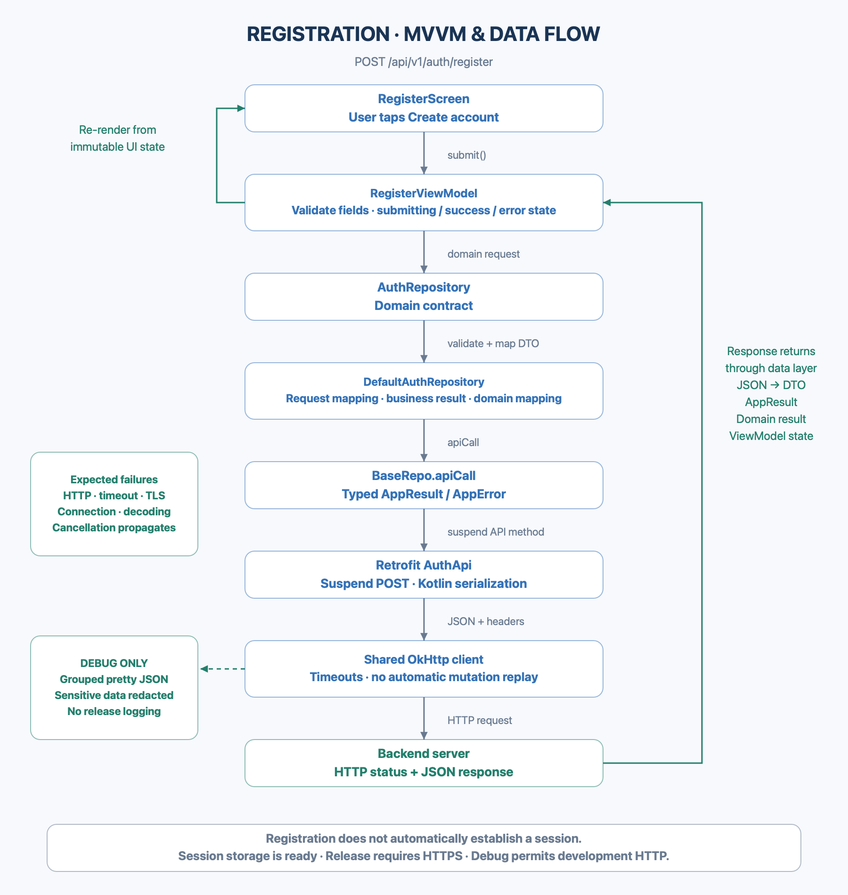
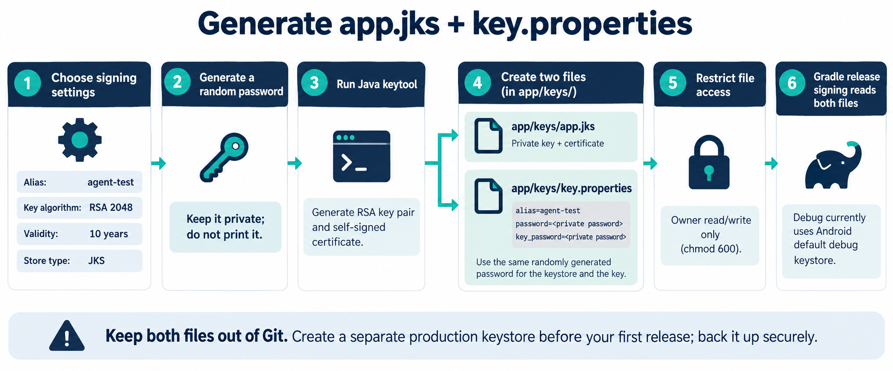
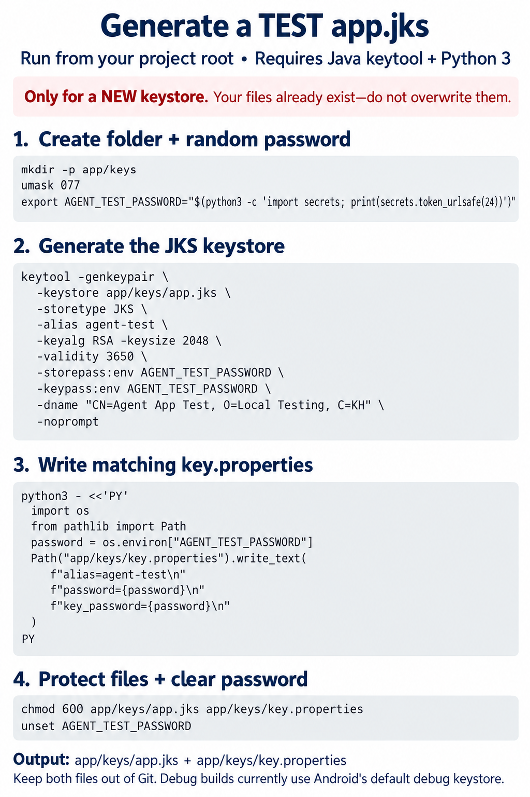
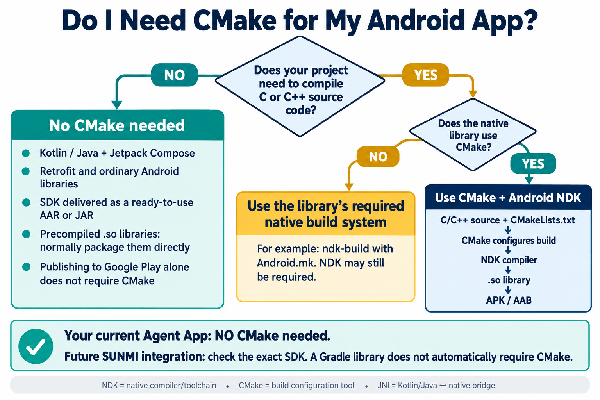

# Agent App

Android app foundation built with Kotlin, Jetpack Compose, MVVM, Retrofit, and a repository-based data layer. The current implementation includes registration, login, encrypted session storage, navigation, environment variants, and English/Khmer strings.

## Technology and platform

| Area | Current setup |
| --- | --- |
| UI | Jetpack Compose and Material 3 |
| State | ViewModel, coroutines, StateFlow |
| Networking | Retrofit 2.11, OkHttp 4.12, Kotlin serialization |
| Dependency wiring | Dagger-Hilt application graph and constructor-injected ViewModels |
| Session storage | AES-GCM encrypted file with a key in Android Keystore |
| Minimum Android | Android 6.0 / API 23 |
| Compile / target SDK | API 37 |
| Build tools | AGP 9.4.1, Gradle 9.6.0; CI uses JDK 25 |
| Languages | English and Khmer (`values-km`) |

## Architecture

The UI owns rendering and user actions. ViewModels validate form input and publish screen state. Domain interfaces define the data operations available to features. Data implementations call APIs, map DTOs, handle transport errors, and manage local sessions.



`AuthRepository` does not automatically persist credentials. `LoginViewModel` explicitly establishes a session after authentication. Registration currently reports success without establishing a session. There is no separate use-case layer in the current login/register flow.

### Startup and navigation



The startup image shows the earlier manual `AppContainer`; current dependency wiring uses Hilt modules and `@HiltViewModel` constructor injection. See [dependency injection](app/document/dependency-injection.md). Session restoration runs in the repository, but automatic routing after restoration/expiry and a logout action are deferred. The diagram's encrypted-preferences utility is separate from the current session store, which uses an encrypted file backed by Android Keystore.

### Data-layer process



The data-layer diagram shows the earlier `AppContainer`; Hilt now wires the same dependencies. It also predates removal of the temporary login-result JSON log. Current debug network logging is redacted; there is no raw login-result log. Home navigation follows the login ViewModel's success state after session persistence; navigation does not yet observe the global session StateFlow.

### Why use a data layer?



Arrow clarification: `LoginViewModel` calls `SessionRepository` directly after authentication succeeds. `DefaultAuthRepository` does not call it or persist sessions automatically.

### Project layout

```text
app/
├── build.gradle.kts                  # Flavors, API URLs, signing, dependencies
├── document/                         # Implementation notes and diagrams
├── keys/                             # Local signing files; excluded from Git
└── src/
    ├── main/
    │   ├── AndroidManifest.xml        # Single app source manifest
    │   ├── java/com/daro/agentapp/
    │   │   ├── AgentApplication.kt
    │   │   ├── MainActivity.kt
    │   │   ├── app/                  # App composable shell
    │   │   ├── di/                   # Hilt providers, scopes, multibindings
    │   │   ├── base/                 # Shared repository transport handling
    │   │   ├── core/                 # Results, configuration, network utilities
    │   │   ├── domain/               # Models and repository contracts
    │   │   ├── data/
    │   │   │   ├── remote/           # Retrofit client, API interfaces, DTOs
    │   │   │   ├── mapper/           # DTO/domain conversions
    │   │   │   ├── repository/       # Concrete data implementations
    │   │   │   └── local/session/    # Encrypted session storage
    │   │   ├── navigation/           # Destinations and navigation graphs
    │   │   └── presentation/         # Screens, ViewModels, screen states
    │   └── res/                      # Shared images, strings, XML resources
    ├── debug/                        # Debug logging and network resource override
    ├── release/                      # Logging implementations that do nothing
    ├── staging/, uat/, preProd/, prod/ # Environment source sets/resources
    ├── test/                         # JVM unit tests
    └── androidTest/                  # Device/emulator tests
scripts/                                 # Configuration and release APK checks
change_package_name.sh                   # Package rename utility
.github/workflows/                       # CI
```

Shared app images belong in `app/src/main/res/drawable/`. Android-version-specific resources, such as `drawable-v24`, can coexist. Architecture diagrams intended only for developers belong in `app/document/images/` so they are not bundled in the APK.

## Authentication and session flow

1. A screen sends input to its ViewModel, which validates fields and sets loading state.
2. The ViewModel calls `AuthRepository.login()` or `register()` with a domain request.
3. `DefaultAuthRepository` maps the request to a DTO and calls `AuthApi`.
4. `BaseRepo` maps HTTP, TLS, timeout, connection, and serialization failures into `AppError`; coroutine cancellation is propagated.
5. The repository validates the success envelope and maps the DTO to `AuthSession`.
6. Login persists the session through `SessionRepository.establish()`. Only successful storage leads to signed-in state and Home. A failure updates the UI error state.
7. Startup restores valid sessions. Expired sessions and logout clear stored credentials and run configured user-data cleanup hooks.

Implemented endpoints:

| Method | Endpoint | Behavior |
| --- | --- | --- |
| POST | `/api/v1/auth/register` | Create account and return an auth response; current UI reports registration success |
| POST | `/api/v1/auth/login` | Authenticate, validate response, then establish a local session |

The client uses 15-second connect, 30-second read/write, and 45-second overall call timeouts. Automatic connection retries and redirects are disabled. Request headers and debug network logging are configured centrally.

### Registration request flow



## Environments

Select a variant in Android Studio's **Build Variants** panel. `stagingDebug` is suitable for daily development.

| Flavor | Application ID | Flavor base URL |
| --- | --- | --- |
| staging | `com.daro.agentapp.staging` | `http://43.224.34.135:3003/` |
| uat | `com.daro.agentapp.uat` | `http://43.224.34.135:3003/` |
| preProd | `com.daro.agentapp.preprod` | `http://43.224.34.135:3003/` |
| prod | `com.daro.agentapp` | `https://43.224.34.135:3003/` |

URLs live in `buildConfigField("String", "API_BASE_URL", ...)` declarations in `app/build.gradle.kts`. Application startup reads `BuildConfig.API_BASE_URL`. The debug build type overrides **all flavors**, including prod, to the HTTP development URL. `BuildConfig.DEBUG` is generated by Android and is not manually redefined.

Release configuration rejects HTTP URLs. Consequently, staging/UAT/preProd release API calls remain disabled until their URLs are changed to HTTPS. Configuring an HTTPS string does not establish that the server supports TLS: the production server certificate and TLS endpoint must be verified before release. Never disable certificate validation to work around a server issue.

The single main manifest uses a Gradle placeholder: cleartext is disabled by default and enabled for debug's API 23 fallback. On newer Android versions, the debug network security resource allows HTTP only for the development host. The shared client also restricts development HTTP to that host.

## Run locally

1. Install Android Studio, SDK Platform 37, and an appropriate Gradle JDK (CI uses JDK 25).
2. Open this project and let Android Studio create `local.properties` with your SDK path.
3. Sync Gradle, select a Debug variant, and run on an API 23+ emulator or device.

```bash
./gradlew :app:assembleStagingDebug
```

APK output: `app/build/outputs/apk/staging/debug/app-staging-debug.apk`.

Debug builds use Android's automatically generated debug keystore; no custom signing files are required.

### Optional release signing

Local release signing reads `app/keys/key.properties` when present:

```properties
alias=YOUR_KEY_ALIAS
password=YOUR_STORE_PASSWORD
key_password=YOUR_KEY_PASSWORD
```

It expects a matching `app/keys/app.jks`. Keep both files private and outside Git. The currently generated local keystore is for testing. Create and securely back up the production signing identity before the first production release. Without local signing properties, a release artifact still requires signing before installation or distribution.

### Test keystore generation guides

These guides describe generating a **new test keystore**, not the Android Keystore used for session encryption. Preserve existing signing files; do not regenerate a password over an existing keystore. Use a separate production signing identity before the first release.





## Native SDK integration: CMake and NDK

This Kotlin/Compose app currently has no C/C++ build and does not need CMake. A ready-to-use SDK dependency does not automatically require native compilation. For future SUNMI integration, follow the requirements of the exact SDK and device model.



## Verify changes

```bash
# Configuration policy
python3 scripts/check_foundation.py

# Package rename utility tests
bash -n change_package_name.sh
python3 -m unittest discover -s scripts/tests -v

# Debug build, JVM tests, lint
./gradlew :app:assembleStagingDebug :app:testStagingDebugUnitTest :app:lintStagingDebug

# Requires a connected emulator/device
./gradlew :app:connectedStagingDebugAndroidTest

# Production release build
./gradlew :app:assembleProdRelease
```

`scripts/verify_release_apk.py` audits the release APK using Android SDK `apkanalyzer`. CI defines checks for all four debug flavors, release policy, emulator tests, and secret scanning. Workflow definitions do not by themselves prove that a particular commit has passed CI; check its GitHub Actions results.

For real-storage lifecycle checks in an isolated, optimized release harness:

```bash
python3 scripts/validate_release_sessions.py --device emulator-5554
python3 scripts/check_production_https.py
```

See [release validation](app/document/release-validation.md) for scope and acceptance gaps. Production TLS currently fails; a passing local session test does not establish live login readiness. Session-state navigation and a visible logout action are still missing from the current UI.

## Logging and release protection

- Ordinary debug network logs use the `AgentNetwork` tag, pretty-print JSON, and redact sensitive values.
- Login and registration ViewModels do not log raw responses or sessions. The temporary `ResponseData==>` login log has been removed. Formatting helpers do not redact data themselves; keep credentials out of manual logs and analytics.
- Release logging implementations do nothing; the release APK audit checks for known debug log tags.
- Session data is encrypted using Android Keystore-backed AES-GCM and stored outside backup storage. Observable session state does not expose tokens.
- Root detection is a heuristic, not proof of device integrity.
- Release R8 code/resource optimization and obfuscation cover the whole app. Custom rules belong in `app/src/release/keepRules/app-rules.keep`; dependency consumer rules and Android defaults remain enabled. There are no blanket app-package keep rules. Keep each release's `app/build/outputs/mapping/prodRelease/mapping.txt` privately for crash retracing; never bundle it inside the APK.
- APK signing verifies app identity; it does not encrypt the application's code. Never embed backend secrets or rely on client checks for server authorization.

To audit whole-app obfuscation alongside manifest/logging checks:

```bash
python3 scripts/verify_release_apk.py app/build/outputs/apk/prod/release/app-prod-release.apk \
  --mapping app/build/outputs/mapping/prodRelease/mapping.txt \
  --apkanalyzer "$ANDROID_HOME/cmdline-tools/latest/bin/apkanalyzer"
```

The APK filename may have an `-unsigned` suffix when signing properties are absent. Mapping checks prove eligible app classes were renamed; they do not prove resistance to reverse engineering. Keep required SDK entry points and reflection targets as narrowly as possible, and test the optimized APK after dependency changes.

## Add a feature

1. Define the domain model and repository contract needed by the feature.
2. Add typed Retrofit endpoints and DTOs, then map them in a data repository implementation. Reuse the shared client and `BaseRepo` transport handling.
3. Bind/provide the implementation in a Hilt module under `di/`; inject its interface into the ViewModel.
4. Add screen state, a ViewModel, Compose UI, and a destination/graph entry. Keep API DTOs out of screen logic.
5. Add English and Khmer strings, and place shared images in `main/res/drawable`.
6. Verify error, loading, success, and relevant session behavior with focused tests.

Home currently contains navigation placeholders for future features; those routes do not imply their backend operations are implemented. There is no automatic token-refresh endpoint flow or Room database implemented in this foundation.

## Rename the package

Commit your work first, then preview and apply:

```bash
./change_package_name.sh --dry-run com.example.newapp
./change_package_name.sh com.example.newapp
```

The script updates the namespace, base application ID, package references, and source folders while preserving flavor suffixes. It does not update registrations in external services. A new application ID creates a separate installed app with separate data. See [package rename instructions](app/document/change-package-name.md).

## More documentation

- [Implementation notes](app/document/implement.md)
- [Hilt dependency injection](app/document/dependency-injection.md)
- [Step-by-step Hilt and feature-flow lessons](app/document/hilt-step-by-step.md)
- [Workflow diagrams](app/document/workflow.md)
- [Release validation and acceptance gaps](app/document/release-validation.md)
- [Package rename guide](app/document/change-package-name.md)

Files in `app/document/reference-imports/` are archived reference material, not compiled application code. Some implementation notes record earlier stages; the current source and this README describe the present configuration.
