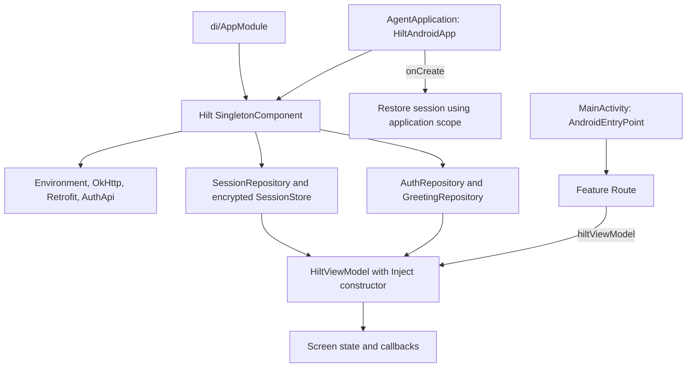

# Dependency injection with Hilt

The app now uses Dagger-Hilt with KSP code generation instead of `AppContainer` and manual ViewModel factories. Dependency injection changes object construction, not repository contracts, API payloads, or session/navigation behavior.

Start with the [step-by-step lessons](hilt-step-by-step.md) for a guided walkthrough of startup, login, and new-feature development.

## Wiring flow



## Lifetimes and ownership

| Dependency | Lifetime / owner |
| --- | --- |
| Environment, client, Retrofit, API | Hilt application singleton |
| Auth, greeting, session repositories | Hilt application singleton |
| Encrypted session store, connectivity monitor | Application singleton; application context only |
| Coroutine scope | Application singleton, qualified with `@ApplicationScope` |
| ViewModels | Navigation destination's ViewModelStore; acquired with `hiltViewModel()` |

`AgentApplication.onCreate()` launches session restoration after Hilt injects its fields. This remains asynchronous; restoration and explicit session establishment still synchronize inside the session repository. Hilt does not implement protected routing, refresh tokens, or logout UI.

`AppModule` uses `Provider<AuthApi>` so an invalid environment returns `UnconfiguredAuthRepository` without constructing Retrofit with an invalid URL. Do not replace this with an eagerly injected API argument without preserving that behavior.

`SessionCleanupModule` declares an initially empty multibound set. Features with user-owned caches can contribute a `SessionDataCleaner` using an application-installed `@Provides @IntoSet` binding. The session repository invokes those cleaners on session clearing.

## Add a feature

1. Inject repository interfaces through a `@HiltViewModel` constructor.
2. For an interface implementation, add a Hilt binding/provider in `di/`; keep transport and storage setup out of screens.
3. Acquire the ViewModel in the Route with `hiltViewModel()` inside its navigation destination.
4. Keep Screen composables independent: pass state and callbacks so previews and UI tests need no Hilt graph.
5. Continue constructing ViewModels directly with fake repository arguments in JVM tests. Hilt is not required for those tests.

Example:

```kotlin
@HiltViewModel
class ProfileViewModel @Inject constructor(
    private val repository: ProfileRepository,
) : ViewModel()
```

Feature examples require their own domain interfaces and provider bindings; annotations alone do not supply an interface implementation.

## Tooling

Versions are pinned in `gradle/libs.versions.toml`: Hilt runtime/compiler/plugin use the same version, KSP runs annotation processing, and AndroidX Hilt Compose supplies `hiltViewModel()`. No kapt or legacy Kotlin Android plugin is added to the existing AGP built-in Kotlin setup. Existing library consumer keep rules remain enabled; do not blanket-keep Hilt-generated classes to conceal an R8 failure.

References: [Hilt Gradle setup](https://dagger.dev/hilt/gradle-setup), [AndroidX Hilt Compose integration](https://developer.android.com/jetpack/androidx/releases/hilt).

Earlier PNG diagrams and archived implementation sections that mention `AppContainer` describe the pre-Hilt wiring; use this flow for current dependency ownership.

## Migration verification

All four debug flavors and the optimized production release built successfully. All 73 JVM tests and 20 emulator instrumentation tests passed, including navigation and activity recreation. A focused provider test confirms that invalid release HTTP configuration returns a configuration error without resolving the API. The production artifact audit confirmed non-debuggable mode, disabled cleartext, absent debug network/raw-response log tags, and renamed application classes. The actual optimized release APK was installed on the emulator; cold startup and Hilt-created login navigation succeeded. Live backend authentication remains outside this migration's validation because the previously reported production TLS problem is unresolved.
