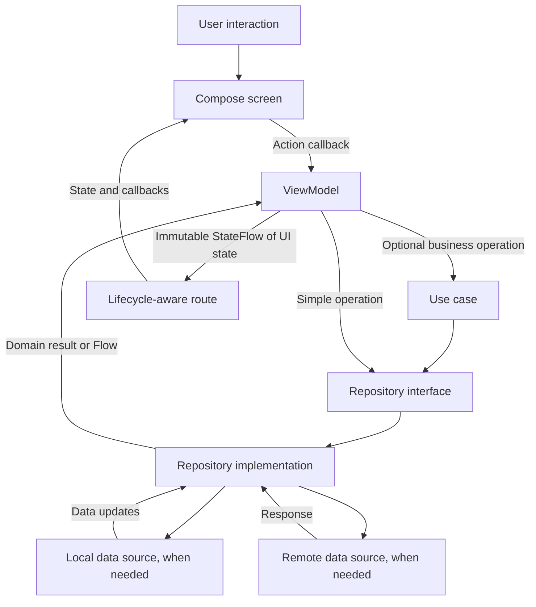

# MVVM implementation proposal

Status: **MVVM foundation implemented following approval.**

This document describes the approved architecture and migration flow. The initial implementation preserves the existing greeting and environment flavors. Feature-specific capabilities below remain conditional on actual product requirements.

## 1. Current project

- Native Android application, package `com.daro.agentapp`.
- Kotlin, Jetpack Compose, and Material 3.
- Thin `MainActivity`, application container, greeting repository, ViewModel, route, stateless screen, and existing theme files.
- Minimum Android API 23 (Android 6.0); compile and target SDK are configured as API 37.
- No navigation graph, database, or network client is needed for the current greeting.

The app's actual features and backend requirements have not been defined. Names such as `Item` below are explanatory placeholders, not proposed product features.

## 2. Architecture

Use MVVM with unidirectional state flow in the existing `app` module. Organize presentation code by feature and keep data and domain responsibilities separate. Start with manual dependency injection; introduce additional modules or a DI framework only when complexity justifies them.



The arrows above describe runtime calls and results. Source dependencies follow these rules:

- Presentation depends on domain contracts and models.
- Data implements domain contracts and depends on domain models.
- Domain stays independent of Compose, Android UI, network clients, and databases.
- The application composition root knows the concrete implementations and wires them together.
- Use cases are optional. Add them for shared business rules or orchestration, not for every repository method.

## 3. Proposed project structure

```text
app/src/main/java/com/daro/agentapp/
├── MainActivity.kt
├── AgentApplication.kt                 # Owns the application dependency container
├── app/
│   ├── AgentApp.kt                     # Theme and root UI
│   └── AppContainer.kt                 # Manual dependency construction
├── navigation/                         # Add when multiple destinations exist
│   └── AppNavHost.kt
├── core/
│   └── common/
│       ├── AppError.kt                 # Typed expected failures
│       └── AppResult.kt                # Success/failure for one-shot operations
├── domain/
│   ├── model/                         # Plain Kotlin business models
│   ├── repository/                    # Repository interfaces
│   └── usecase/                       # Only operations needing business logic
├── data/
│   ├── repository/                    # Repository implementations
│   ├── mapper/                        # DTO/entity ↔ domain transformations
│   ├── local/                         # Add only if persistence is required
│   │   ├── dao/
│   │   └── entity/
│   └── remote/                        # Add only if a backend is required
│       ├── api/
│       └── dto/
├── presentation/
│   └── <feature_name>/
│       ├── <Feature>Route.kt           # Gets ViewModel, collects state, handles navigation
│       ├── <Feature>Screen.kt          # Stateless Compose UI
│       ├── <Feature>ViewModel.kt       # Actions, state, coroutine coordination
│       ├── <Feature>UiState.kt         # Immutable screen state
│       └── components/                # Feature-specific reusable UI
└── ui/
    ├── components/                    # UI actually shared across features
    └── theme/                         # Preserve existing theme files
```

Create directories only as their implementations become necessary. Keep `MainActivity.kt` in its existing package so the manifest activity reference remains valid. Test packages should mirror the production packages under `src/test` and `src/androidTest`.

## 4. Responsibilities

| Component | Owns | Must avoid |
| --- | --- | --- |
| MainActivity | Android entry point and root composition | Business logic and data access |
| Route | ViewModel acquisition, lifecycle collection, navigation callbacks | Repository calls |
| Screen | Rendering state and forwarding user actions | Constructing dependencies or launching data requests |
| ViewModel | UI state, validation for presentation, operation coordination | Activity references, navigation controllers, DTOs, database entities |
| Use case | Reusable business policy and multi-repository operations | UI resources and screen state |
| Repository interface | Domain-facing operations and observation contracts | Concrete transport/storage types |
| Repository implementation | Data coordination, mapping, cache policy, error translation | Compose state and navigation |
| Data source | Network or storage operations | Screen behavior and business orchestration |
| AppContainer | Shared dependencies and ViewModel factories | Mutable screen state |

## 5. Full screen flow

### Startup and ownership

1. Android creates `AgentApplication`, which creates one application-scoped `AppContainer`.
2. The container creates repositories and any required data sources. Construction must not block the main thread.
3. `MainActivity` calls `setContent` and renders `AgentApp`.
4. The route obtains its ViewModel through a factory backed by the container. Scope it to its screen/navigation entry, not a global singleton.
5. The route collects `uiState` using `collectAsStateWithLifecycle()` and passes state plus callbacks into the screen.
6. Compose recomposition only renders state. It does not construct repositories or repeat initial loading.

### Initial load and observation

1. The ViewModel starts one observation pipeline for screen data.
2. It exposes a public read-only `StateFlow<FeatureUiState>` and keeps mutable state private.
3. For observable repositories, map the repository stream into UI state and share it with `stateIn(viewModelScope, SharingStarted.WhileSubscribed(5_000), initialState)` where appropriate.
4. Execute one-shot loads in `viewModelScope`. Use `init` only when loading is independent of UI subscriptions and must run once per ViewModel instance.
5. The repository loads data according to the selected persistence policy, maps data into domain models, and returns results.
6. The ViewModel represents content, loading, empty content, and recoverable errors explicitly.
7. The route receives updated state and Compose redraws the affected UI.

Choose one initial-load strategy per screen. Do not trigger the same request from both `init` and a composable effect.

### User action and write operation

1. The user taps a button or edits a field.
2. The screen invokes a typed callback such as `onSave()` or `onQueryChange(value)`.
3. The ViewModel updates local input state, checks presentation requirements, and starts the operation.
4. A use case enforces business rules when needed; otherwise the ViewModel calls the repository directly.
5. The repository performs the write and returns a typed result.
6. For persisted observable data, the updated data source emits the new content. The ViewModel consumes that stream instead of maintaining a second independent copy.
7. The ViewModel clears submitting state and exposes success or failure. Prevent duplicate submissions while an operation is active.
8. The UI displays the outcome and offers retry when appropriate.

### Refresh, search, and concurrency

- Refresh preserves existing content and sets `isRefreshing`; a refresh failure should not discard usable content.
- Debounce search input when requests are expensive. Use `flatMapLatest` or explicit cancellation so older results cannot overwrite a newer query.
- Serialize writes that must preserve order. Do not apply latest-request cancellation indiscriminately to writes.
- Define whether duplicate refresh requests are ignored or cancel and replace the current request.
- Retry only when requested or under an explicit bounded policy. Avoid automatic infinite retry loops.

## 6. UI state contract

Use an immutable state object per screen. An illustrative list screen could have:

```kotlin
data class ItemsUiState(
    val items: List<Item> = emptyList(),
    val query: String = "",
    val isInitialLoading: Boolean = true,
    val isRefreshing: Boolean = false,
    val isSubmitting: Boolean = false,
    val error: UiError? = null,
    val pendingMessage: UiMessage? = null,
)
```

`Item`, `UiError`, and `UiMessage` are placeholders to define with the first real feature. Document valid combinations: initial loading ends after success or failure; empty content is shown only after a successful empty load; refreshing can coexist with content; submitting applies only to the relevant action.

Expose semantic errors and resolve localized strings in the UI. Never display raw exception messages or sensitive server responses.

Keep important operation outcomes in state. For transient messages, use an identified pending message and an acknowledgment callback after display; specify queue behavior if multiple messages can arrive. Do not rely on a no-replay event stream for outcomes the user must see after lifecycle changes.

## 7. Data and repository contracts

- Repository interfaces expose domain models, `Flow` for observed data, and suspend functions for one-shot operations.
- Use a small typed result such as `AppResult.Success<T>` / `AppResult.Failure(AppError)` for expected one-shot failures. Define observation error and retry behavior explicitly for each repository.
- Map transport DTOs and storage entities at the data boundary; do not pass them to Compose.
- Catch expected failures at the appropriate boundary. Always propagate coroutine cancellation rather than turning it into a user-facing error.
- Blocking disk operations must run on an IO dispatcher. Use suspend APIs that already handle dispatching correctly without wrapping every call unnecessarily.
- Inject dispatchers where custom blocking work needs them and where deterministic coroutine tests require control.
- Select the source of truth per feature: for persisted offline data, observe local storage and let remote refresh update it; for a simple remote-only feature, return remote data directly.
- Add cache expiry, pagination, conflict handling, or optimistic updates only after the feature requirements justify and define them.

## 8. Navigation and lifecycle

- Keep navigation controllers in the UI layer. Screen callbacks or the route translate completed actions into navigation.
- Pass stable identifiers between destinations; retrieve full objects through repositories.
- Use `SavedStateHandle` for small restorable inputs and route arguments. Reload durable data from storage or the backend after process recreation.
- ViewModels survive configuration changes but do not survive process death.
- Use `rememberSaveable` for small UI-only details such as an expanded panel when restoration is appropriate.
- Cancel screen work through `viewModelScope`. Work that must survive leaving the screen needs a separately designed persistent-work mechanism.
- Handle a successful save and subsequent navigation so recreation does not accidentally repeat the write or navigate twice.

## 9. Dependency plan

After approval, verify compatibility against the existing version catalog and Android minimum before adding dependencies. This proposal does not select new version numbers.

| Capability | Proposed choice | When to add |
| --- | --- | --- |
| ViewModel and Compose integration | AndroidX lifecycle ViewModel Compose | First MVVM screen |
| Lifecycle-aware state collection | AndroidX lifecycle Runtime Compose | First MVVM screen |
| Coroutines and Flow | Explicit kotlinx-coroutines dependencies | First asynchronous implementation |
| Dependency injection | Manual AppContainer and ViewModel factories | First MVVM screen |
| Navigation | AndroidX Navigation Compose | Multiple destinations |
| Database | Room | Confirmed structured local persistence |
| Preferences | DataStore | Confirmed persistent settings |
| Networking | Choose client and serialization from backend needs | Confirmed API contract |
| Coroutine tests | kotlinx-coroutines-test | ViewModel/repository tests |

Use `gradle/libs.versions.toml` for new aliases. Add the application class to the manifest only when it is implemented. Add network permissions only if networking is actually required. Preserve the current minimum SDK unless you explicitly approve a compatibility change.

## 10. Migration sequence after approval

1. Confirm the first real feature, its screens, required data, and acceptance criteria.
2. Add only the lifecycle and coroutine dependencies needed for that feature; resolve compatibility and run a debug build.
3. Introduce `AgentApp`, `AgentApplication`, and `AppContainer`, preserving the existing theme and launcher entry point.
4. Define the feature's domain models and repository contract, plus typed expected errors.
5. Implement the required data source and repository. Use a fake implementation only as an explicit temporary development choice.
6. Add the feature UI state, ViewModel, and factory.
7. Split the feature into a route that collects state and a stateless screen that renders it.
8. Wire the feature into the root UI; add navigation only when there is another destination.
9. Cover the behaviors listed below, build, and manually inspect loading, empty, error, content, and retry states.
10. Remove the sample greeting once the approved replacement works, and update this document to describe the final structure.

Keep each step buildable. Do not scaffold unused layers, migrate theme files unnecessarily, or introduce multiple Gradle modules in this initial change.

## 11. Verification and acceptance

Test observable behavior rather than matching implementation details:

- ViewModel: loading to content, successful empty result, failure and retry, preserved content during refresh failure, and duplicate-submit protection.
- Concurrency: stale search results cannot replace current results; canceled operations remain canceled.
- Repository: mapping, expected error conversion, and source-of-truth behavior for the chosen storage policy.
- Compose: representative screen states render correctly and actions invoke the expected callbacks.
- Lifecycle: rotation does not duplicate requests or writes; navigation returns correctly; process recreation restores supported inputs and reloads data.
- Build: run `./gradlew :app:assembleDebug :app:testStagingDebugUnitTest :app:testUatDebugUnitTest :app:testPreProdDebugUnitTest :app:testProdDebugUnitTest`; run connected instrumentation checks when a device or emulator is available.
- Compatibility: verify the minimum supported Android API and a current available emulator/device after any dependency changes.

Architecture acceptance: Compose screens have no direct data access; UI state is immutable to callers; repositories expose domain types; dependencies are supplied through the composition root; no unapproved functionality or SDK changes are introduced.

## 12. Future feature decisions

Before adding a product feature, determine:

- The proposed single-module package structure and manual DI approach.
- The first feature and its actual screen/data requirements.
- Whether that feature needs remote data, local persistence, offline behavior, or multiple destinations.
- Any preferred networking, storage, navigation, or DI libraries.

## 13. Implemented foundation

```text
com/daro/agentapp/
├── MainActivity.kt
├── AgentApplication.kt
├── app/
│   ├── AgentApp.kt
│   └── AppContainer.kt
├── data/repository/DefaultGreetingRepository.kt
├── domain/
│   ├── model/Greeting.kt
│   └── repository/GreetingRepository.kt
├── presentation/greeting/
│   ├── GreetingRoute.kt
│   ├── GreetingScreen.kt
│   ├── GreetingViewModel.kt
│   └── GreetingUiState.kt
└── ui/theme/                         # Existing theme retained
```

`AgentApplication` owns the container; its factory creates a screen-scoped ViewModel. The repository emits the existing built-in greeting. The ViewModel maps it into read-only state, shared while subscribed. The route collects state with lifecycle awareness, and the screen renders loading or content. Greeting text uses an Android string resource.

The built-in greeting has no failing operations, writes, search, or empty-list semantics, so error/retry/submission flows and their tests are deferred until a feature requires them. No fake backend, database, empty packages, or unnecessary use case has been added. `core`, data sources, mappers, navigation, and use cases in the proposed tree are extension points rather than created directories.

All four flavors (`staging`, `uat`, `preProd`, `prod`) and the configured minimum SDK remain unchanged. ViewModel tests cover initial loading, the existing greeting, and repository updates. Instrumentation tests verify application wiring, visible greeting content, and activity recreation on the connected Android 15 (API 35) emulator.


### Validation results

- All four debug APKs assembled successfully.
- Unit tests passed for staging, UAT, pre-production, and production debug variants.
- `:app:connectedStagingDebugAndroidTest` passed on Android 15 / API 35, including activity recreation.
- Android 6.0 / API 23 runtime behavior, process-death restoration, and release signing were not exercised.

## 14. Environment source sets

Shared Kotlin code, manifest, and resources remain in `app/src/main`. Each build combines `main`, its environment source set, and its build-type source set if present. For example, `stagingDebug` uses `main` plus `staging` plus any `debug` overrides.

```text
app/src/
├── main/                            # Shared application implementation
├── staging/res/values/config.xml
├── uat/res/values/config.xml
├── preProd/res/values/config.xml
├── prod/res/values/config.xml
├── test/                            # Shared unit tests
└── androidTest/                     # Shared instrumentation tests
```

Each flavor defines `R.string.api_base_url`, currently `http://43.224.34.135:3003/` for all four environments because only one URL was supplied. Edit each environment's `config.xml` independently when separate servers are available. Android selects the resource for the active build variant; no runtime environment switch is needed.

This adds configuration only; no API client or requests are implemented. The supplied URL uses HTTP. When networking is implemented, add Internet permission and an appropriately scoped cleartext policy (or use HTTPS) because the current target blocks cleartext by default.

### Environment image and media resources

Each of `staging`, `uat`, `preProd`, and `prod` now has these directories under `res/`:

```text
res/
├── drawable/         # Drawable XML and density-scaled images
├── drawable-nodpi/   # Images that should not be density-scaled
├── mipmap-mdpi/      # Launcher icons at baseline density
├── mipmap-hdpi/
├── mipmap-xhdpi/
├── mipmap-xxhdpi/
├── mipmap-xxxhdpi/
├── raw/              # Raw media files
└── values/config.xml
```

Empty resource directories contain `.gitkeep` files so Git retains them. Place shared images in `src/main/res`; place environment-specific images in the matching flavor's `res`. A flavor resource with the same name and configuration overrides the shared resource for that variant. No image assets were duplicated or changed.
