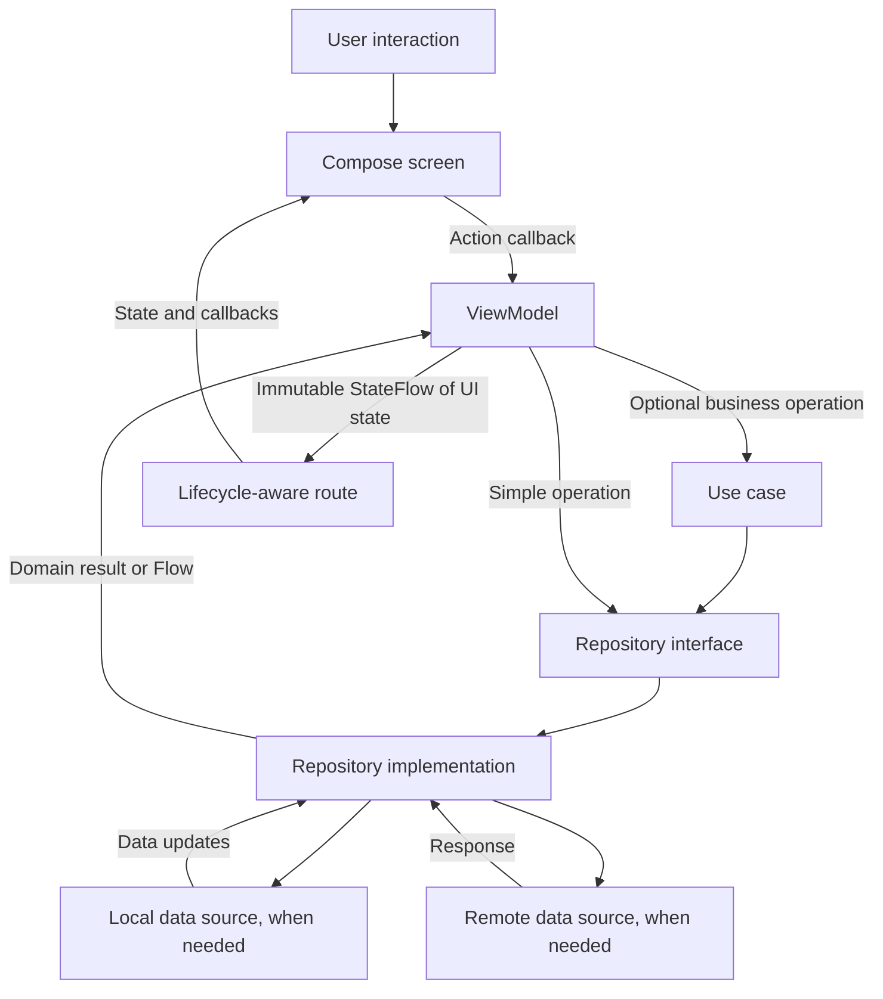

# MVVM implementation proposal

Status: **MVVM foundation implemented following approval.**

Current networking uses **Retrofit + Kotlin serialization + shared OkHttp**. Section 23 adds the current session, storage, environment, UI-state, and CI foundation. Earlier sections record implementation history and are superseded where noted.

This document describes the approved architecture and migration flow. The initial implementation preserves the existing greeting and environment flavors. Feature-specific capabilities below remain conditional on actual product requirements.

## 1. Current project

- Native Android application, package `com.daro.agentapp`.
- Kotlin, Jetpack Compose, and Material 3.
- Thin `MainActivity`, application container, greeting repository, ViewModel, route, stateless screen, and existing theme files.
- Minimum Android API 23 (Android 6.0); compile and target SDK are configured as API 37.
- Greeting UI remains the launcher. Registration networking is implemented through `AuthRepository`, with a registration form and Navigation Compose graph. No database has been added.

The app's actual features and backend requirements have not been defined. Names such as `Item` below are explanatory placeholders, not proposed product features.

## 2. Architecture

Use MVVM with unidirectional state flow in the existing `app` module. Organize presentation code by feature and keep data and domain responsibilities separate. Start with manual dependency injection; introduce additional modules or a DI framework only when complexity justifies them.



The arrows above describe runtime calls and results. Source dependencies follow these rules:

- Presentation depends on domain contracts and models.
- Data implements domain contracts and depends on domain models.
- Domain stays independent of Compose, Android UI, network clients, and databases.
- The application composition root knows the concrete implementations and wires them together.
- Use cases are optional. Add them for shared business rules or orchestration, not for every repository method.

## 3. Proposed project structure

```text
app/src/main/java/com/daro/agentapp/
├── MainActivity.kt
├── AgentApplication.kt                 # Owns the application dependency container
├── app/
│   ├── AgentApp.kt                     # Theme and root UI
│   └── AppContainer.kt                 # Manual dependency construction
├── navigation/                         # Add when multiple destinations exist
│   └── AppNavHost.kt
├── core/
│   └── common/
│       ├── AppError.kt                 # Typed expected failures
│       └── AppResult.kt                # Success/failure for one-shot operations
├── domain/
│   ├── model/                         # Plain Kotlin business models
│   ├── repository/                    # Repository interfaces
│   └── usecase/                       # Only operations needing business logic
├── data/
│   ├── repository/                    # Repository implementations
│   ├── mapper/                        # DTO/entity ↔ domain transformations
│   ├── local/                         # Add only if persistence is required
│   │   ├── dao/
│   │   └── entity/
│   └── remote/                        # Add only if a backend is required
│       ├── api/
│       └── dto/
├── presentation/
│   └── <feature_name>/
│       ├── <Feature>Route.kt           # Gets ViewModel, collects state, handles navigation
│       ├── <Feature>Screen.kt          # Stateless Compose UI
│       ├── <Feature>ViewModel.kt       # Actions, state, coroutine coordination
│       ├── <Feature>UiState.kt         # Immutable screen state
│       └── components/                # Feature-specific reusable UI
└── ui/
    ├── components/                    # UI actually shared across features
    └── theme/                         # Preserve existing theme files
```

Create directories only as their implementations become necessary. Keep `MainActivity.kt` in its existing package so the manifest activity reference remains valid. Test packages should mirror the production packages under `src/test` and `src/androidTest`.

## 4. Responsibilities

| Component | Owns | Must avoid |
| --- | --- | --- |
| MainActivity | Android entry point and root composition | Business logic and data access |
| Route | ViewModel acquisition, lifecycle collection, navigation callbacks | Repository calls |
| Screen | Rendering state and forwarding user actions | Constructing dependencies or launching data requests |
| ViewModel | UI state, validation for presentation, operation coordination | Activity references, navigation controllers, DTOs, database entities |
| Use case | Reusable business policy and multi-repository operations | UI resources and screen state |
| Repository interface | Domain-facing operations and observation contracts | Concrete transport/storage types |
| Repository implementation | Data coordination, mapping, cache policy, error translation | Compose state and navigation |
| Data source | Network or storage operations | Screen behavior and business orchestration |
| AppContainer | Shared dependencies and ViewModel factories | Mutable screen state |

## 5. Full screen flow

### Startup and ownership

1. Android creates `AgentApplication`, which creates one application-scoped `AppContainer`.
2. The container creates repositories and any required data sources. Construction must not block the main thread.
3. `MainActivity` calls `setContent` and renders `AgentApp`.
4. The route obtains its ViewModel through a factory backed by the container. Scope it to its screen/navigation entry, not a global singleton.
5. The route collects `uiState` using `collectAsStateWithLifecycle()` and passes state plus callbacks into the screen.
6. Compose recomposition only renders state. It does not construct repositories or repeat initial loading.

### Initial load and observation

1. The ViewModel starts one observation pipeline for screen data.
2. It exposes a public read-only `StateFlow<FeatureUiState>` and keeps mutable state private.
3. For observable repositories, map the repository stream into UI state and share it with `stateIn(viewModelScope, SharingStarted.WhileSubscribed(5_000), initialState)` where appropriate.
4. Execute one-shot loads in `viewModelScope`. Use `init` only when loading is independent of UI subscriptions and must run once per ViewModel instance.
5. The repository loads data according to the selected persistence policy, maps data into domain models, and returns results.
6. The ViewModel represents content, loading, empty content, and recoverable errors explicitly.
7. The route receives updated state and Compose redraws the affected UI.

Choose one initial-load strategy per screen. Do not trigger the same request from both `init` and a composable effect.

### User action and write operation

1. The user taps a button or edits a field.
2. The screen invokes a typed callback such as `onSave()` or `onQueryChange(value)`.
3. The ViewModel updates local input state, checks presentation requirements, and starts the operation.
4. A use case enforces business rules when needed; otherwise the ViewModel calls the repository directly.
5. The repository performs the write and returns a typed result.
6. For persisted observable data, the updated data source emits the new content. The ViewModel consumes that stream instead of maintaining a second independent copy.
7. The ViewModel clears submitting state and exposes success or failure. Prevent duplicate submissions while an operation is active.
8. The UI displays the outcome and offers retry when appropriate.

### Refresh, search, and concurrency

- Refresh preserves existing content and sets `isRefreshing`; a refresh failure should not discard usable content.
- Debounce search input when requests are expensive. Use `flatMapLatest` or explicit cancellation so older results cannot overwrite a newer query.
- Serialize writes that must preserve order. Do not apply latest-request cancellation indiscriminately to writes.
- Define whether duplicate refresh requests are ignored or cancel and replace the current request.
- Retry only when requested or under an explicit bounded policy. Avoid automatic infinite retry loops.

## 6. UI state contract

Use an immutable state object per screen. An illustrative list screen could have:

```kotlin
data class ItemsUiState(
    val items: List<Item> = emptyList(),
    val query: String = "",
    val isInitialLoading: Boolean = true,
    val isRefreshing: Boolean = false,
    val isSubmitting: Boolean = false,
    val error: UiError? = null,
    val pendingMessage: UiMessage? = null,
)
```

`Item`, `UiError`, and `UiMessage` are placeholders to define with the first real feature. Document valid combinations: initial loading ends after success or failure; empty content is shown only after a successful empty load; refreshing can coexist with content; submitting applies only to the relevant action.

Expose semantic errors and resolve localized strings in the UI. Never display raw exception messages or sensitive server responses.

Keep important operation outcomes in state. For transient messages, use an identified pending message and an acknowledgment callback after display; specify queue behavior if multiple messages can arrive. Do not rely on a no-replay event stream for outcomes the user must see after lifecycle changes.

## 7. Data and repository contracts

- Repository interfaces expose domain models, `Flow` for observed data, and suspend functions for one-shot operations.
- Use a small typed result such as `AppResult.Success<T>` / `AppResult.Failure(AppError)` for expected one-shot failures. Define observation error and retry behavior explicitly for each repository.
- Map transport DTOs and storage entities at the data boundary; do not pass them to Compose.
- Catch expected failures at the appropriate boundary. Always propagate coroutine cancellation rather than turning it into a user-facing error.
- Blocking disk operations must run on an IO dispatcher. Use suspend APIs that already handle dispatching correctly without wrapping every call unnecessarily.
- Inject dispatchers where custom blocking work needs them and where deterministic coroutine tests require control.
- Select the source of truth per feature: for persisted offline data, observe local storage and let remote refresh update it; for a simple remote-only feature, return remote data directly.
- Add cache expiry, pagination, conflict handling, or optimistic updates only after the feature requirements justify and define them.

## 8. Navigation and lifecycle

- Keep navigation controllers in the UI layer. Screen callbacks or the route translate completed actions into navigation.
- Pass stable identifiers between destinations; retrieve full objects through repositories.
- Use `SavedStateHandle` for small restorable inputs and route arguments. Reload durable data from storage or the backend after process recreation.
- ViewModels survive configuration changes but do not survive process death.
- Use `rememberSaveable` for small UI-only details such as an expanded panel when restoration is appropriate.
- Cancel screen work through `viewModelScope`. Work that must survive leaving the screen needs a separately designed persistent-work mechanism.
- Handle a successful save and subsequent navigation so recreation does not accidentally repeat the write or navigate twice.

## 9. Dependency plan

After approval, verify compatibility against the existing version catalog and Android minimum before adding dependencies. This proposal does not select new version numbers.

| Capability | Proposed choice | When to add |
| --- | --- | --- |
| ViewModel and Compose integration | AndroidX lifecycle ViewModel Compose | First MVVM screen |
| Lifecycle-aware state collection | AndroidX lifecycle Runtime Compose | First MVVM screen |
| Coroutines and Flow | Explicit kotlinx-coroutines dependencies | First asynchronous implementation |
| Dependency injection | Manual AppContainer and ViewModel factories | First MVVM screen |
| Navigation | AndroidX Navigation Compose | Multiple destinations |
| Database | Room | Confirmed structured local persistence |
| Preferences | DataStore | Confirmed persistent settings |
| Networking | Choose client and serialization from backend needs | Confirmed API contract |
| Coroutine tests | kotlinx-coroutines-test | ViewModel/repository tests |

Use `gradle/libs.versions.toml` for new aliases. Add the application class to the manifest only when it is implemented. Add network permissions only if networking is actually required. Preserve the current minimum SDK unless you explicitly approve a compatibility change.

## 10. Migration sequence after approval

1. Confirm the first real feature, its screens, required data, and acceptance criteria.
2. Add only the lifecycle and coroutine dependencies needed for that feature; resolve compatibility and run a debug build.
3. Introduce `AgentApp`, `AgentApplication`, and `AppContainer`, preserving the existing theme and launcher entry point.
4. Define the feature's domain models and repository contract, plus typed expected errors.
5. Implement the required data source and repository. Use a fake implementation only as an explicit temporary development choice.
6. Add the feature UI state, ViewModel, and factory.
7. Split the feature into a route that collects state and a stateless screen that renders it.
8. Wire the feature into the root UI; add navigation only when there is another destination.
9. Cover the behaviors listed below, build, and manually inspect loading, empty, error, content, and retry states.
10. Remove the sample greeting once the approved replacement works, and update this document to describe the final structure.

Keep each step buildable. Do not scaffold unused layers, migrate theme files unnecessarily, or introduce multiple Gradle modules in this initial change.

## 11. Verification and acceptance

Test observable behavior rather than matching implementation details:

- ViewModel: loading to content, successful empty result, failure and retry, preserved content during refresh failure, and duplicate-submit protection.
- Concurrency: stale search results cannot replace current results; canceled operations remain canceled.
- Repository: mapping, expected error conversion, and source-of-truth behavior for the chosen storage policy.
- Compose: representative screen states render correctly and actions invoke the expected callbacks.
- Lifecycle: rotation does not duplicate requests or writes; navigation returns correctly; process recreation restores supported inputs and reloads data.
- Build: run `./gradlew :app:assembleDebug :app:testStagingDebugUnitTest :app:testUatDebugUnitTest :app:testPreProdDebugUnitTest :app:testProdDebugUnitTest`; run connected instrumentation checks when a device or emulator is available.
- Compatibility: verify the minimum supported Android API and a current available emulator/device after any dependency changes.

Architecture acceptance: Compose screens have no direct data access; UI state is immutable to callers; repositories expose domain types; dependencies are supplied through the composition root; no unapproved functionality or SDK changes are introduced.

## 12. Future feature decisions

Before adding a product feature, determine:

- The proposed single-module package structure and manual DI approach.
- The first feature and its actual screen/data requirements.
- Whether that feature needs remote data, local persistence, offline behavior, or multiple destinations.
- Any preferred networking, storage, navigation, or DI libraries.

## 13. Implemented foundation

```text
com/daro/agentapp/
├── MainActivity.kt
├── AgentApplication.kt
├── app/
│   ├── AgentApp.kt
│   └── AppContainer.kt
├── data/repository/DefaultGreetingRepository.kt
├── domain/
│   ├── model/Greeting.kt
│   └── repository/GreetingRepository.kt
├── presentation/greeting/
│   ├── GreetingRoute.kt
│   ├── GreetingScreen.kt
│   ├── GreetingViewModel.kt
│   └── GreetingUiState.kt
└── ui/theme/                         # Existing theme retained
```

`AgentApplication` owns the container; its factory creates a screen-scoped ViewModel. The repository emits the existing built-in greeting. The ViewModel maps it into read-only state, shared while subscribed. The route collects state with lifecycle awareness, and the screen renders loading or content. Greeting text uses an Android string resource.

The built-in greeting has no failing operations, writes, search, or empty-list semantics, so error/retry/submission flows and their tests are deferred until a feature requires them. No fake backend, database, empty packages, or unnecessary use case has been added. Subsequent work adds `core` utilities/results and registration data sources/mappers (sections 15–16). Navigation was added for registration (section 17); use cases remain an extension point.

All four flavors (`staging`, `uat`, `preProd`, `prod`) and the configured minimum SDK remain unchanged. ViewModel tests cover initial loading, the existing greeting, and repository updates. Instrumentation tests verify application wiring, visible greeting content, and activity recreation on the connected Android 15 (API 35) emulator.


### Validation results

- All four debug APKs assembled successfully.
- Unit tests passed for staging, UAT, pre-production, and production debug variants.
- `:app:connectedStagingDebugAndroidTest` passed on Android 15 / API 35, including activity recreation.
- Android 6.0 / API 23 runtime behavior, process-death restoration, and release signing were not exercised.

## 14. Environment source sets

Shared Kotlin code, manifest, and resources remain in `app/src/main`. Each build combines `main`, its environment source set, and its build-type source set if present. For example, `stagingDebug` uses `main` plus `staging` plus any `debug` overrides.

```text
app/src/
├── main/                            # Shared application implementation
├── staging/res/values/config.xml
├── uat/res/values/config.xml
├── preProd/res/values/config.xml
├── prod/res/values/config.xml
├── test/                            # Shared unit tests
└── androidTest/                     # Shared instrumentation tests
```

Each flavor defines `BuildConfig.API_BASE_URL` in `app/build.gradle.kts`. Production uses HTTPS; staging, UAT, and preProd use the supplied HTTP development server. The debug build type overrides the URL to HTTP for every flavor. Release HTTPS validation remains enforced. No runtime environment switch is needed.

The registration implementation in section 16 consumes this configuration, adds Internet permission, and permits HTTP for the supplied server. HTTPS is still needed for encrypted transport.

### Environment image and media resources

Each of `staging`, `uat`, `preProd`, and `prod` now has these directories under `res/`:

```text
res/
├── drawable/         # Drawable XML and density-scaled images
├── drawable-nodpi/   # Images that should not be density-scaled
├── mipmap-mdpi/      # Launcher icons at baseline density
├── mipmap-hdpi/
├── mipmap-xhdpi/
├── mipmap-xxhdpi/
├── mipmap-xxxhdpi/
├── raw/              # Raw media files
└── values/config.xml
```

Empty resource directories contain `.gitkeep` files so Git retains them. Place shared images in `src/main/res`; place environment-specific images in the matching flavor's `res`. A flavor resource with the same name and configuration overrides the shared resource for that variant. No image assets were duplicated or changed.

## 15. Root detection utility

`core/utils/RootDetection.kt` provides suspend functions `isDeviceRooted()` and `check()`. Call from a coroutine (for example `viewModelScope.launch`); filesystem probes run on `Dispatchers.IO`. `check()` returns detected paths, test-key status, and paths denied by a `SecurityException`.

```kotlin
viewModelScope.launch {
    val result = RootDetection.check()
    // Update the feature's UI state from result.isRootSuspected.
}
```

The utility checks known su/Magisk paths without executing `su`, requesting privileges, adding dependencies, or blocking the app. Test-key firmware alone does not count as root. A false result means no configured artifact was observed, not that the device is trusted; hidden files, SELinux, and root-hiding tools can defeat these checks. File.exists can return false for inaccessible files without throwing, so inaccessiblePaths is not a complete visibility report. App-blocking policy and server attestation are not implemented.

## 16. Registration endpoint

Implemented `POST /api/v1/auth/register` with the supplied JSON request and success envelope. The initial direct OkHttp implementation was migrated to Retrofit in section 22. `AppContainer.authRepository` exposes `AuthRepository.register(RegisterRequest): AppResult<AuthSession>` to feature ViewModels. The application reads `BuildConfig.API_BASE_URL` when constructing the container.

### Data flow

```text
ViewModel coroutine → AuthRepository → DefaultAuthRepository
    → AuthApi → OkHttp POST → response DTO → domain AuthSession
```

- Domain models: `RegisterRequest`, `AuthSession`, and `AuthUser`.
- Data DTOs mirror all supplied field names, including `dateBirth` and `interested`.
- Kotlin serialization requires complete session fields, tolerates extra response fields, and keeps DTOs behind the data layer. JSON processing runs on the Default dispatcher; HTTP uses asynchronous OkHttp calls.
- Request coordinates must be finite and within latitude/longitude bounds. Other field validation remains authoritative on the backend until its rules are provided. Date format is `yyyy-MM-dd`; `gender`, role, and provider remain strings because the full allowed-value contracts were not supplied.
- `AppError` represents connection, timeout, TLS, invalid response, business rejection, invalid coordinates, and HTTP errors with a status code. Raw error bodies and server messages are not exposed to UI or retained in errors.
- Connect timeout: 15 seconds; read/write: 30 seconds; total call: 45 seconds.
- No automatic connection retries or redirect following. The registration request body is one-shot so follow-up retries cannot replay it. A timeout can mean the backend created an account even though the client received no result; do not automatically resubmit.
- Coroutine cancellation cancels the call and propagates as cancellation. Response bodies are always closed.
- Debug-only sanitized JSON logging is described in section 19. Request/session/user objects redact their default string representation. Callers must also avoid logging individual sensitive fields.
- Tokens are returned in memory only. Secure persistence, login, refresh, and logout remain unimplemented. The registration form/ViewModel is described in section 17.

### Calling from a feature ViewModel

Inject `AuthRepository` through its ViewModel factory, then call from a lifecycle-owned coroutine:

```kotlin
viewModelScope.launch {
    when (val result = authRepository.register(request)) {
        is AppResult.Success -> {
            val session = result.value
            // Hand off to the session owner; never log or put tokens in saved UI state.
        }
        is AppResult.Failure -> {
            // Map result.error into a localized, feature-specific UI state.
        }
    }
}
```

### HTTP configuration

Internet permission and Network Security Configuration were added. Cleartext is denied by default with an exception for `43.224.34.135`. Android 6.0 does not support Network Security Configuration, so the manifest permits cleartext for compatibility and the shared client additionally enforces the same host restriction. Redirects are disabled. Normal HTTPS certificate validation remains enabled.

All flavors still use the one supplied HTTP URL. Passwords and tokens sent through this server are **not encrypted in transit**. Replace environment URLs with an HTTPS endpoint and remove the HTTP exception when the backend supports TLS.

### Verification

All four debug APKs assembled. Staging unit tests passed (18 tests total, including 11 registration/network tests). Registration tests use MockWebServer and synthetic credentials: request shape, successful mapping, HTTP status failures, API rejection, malformed/incomplete sessions, coordinate validation, timeouts, connection failures, redirects, non-replay on 503, cancellation, and timeout configuration. No account was created on the real backend. Optimized `:app:assembleStagingRelease` and release vital lint passed. R8 emitted missing optional/platform type warnings (including Conscrypt and AndroidX); no blanket keep or suppression rules were added. Release runtime behavior was not exercised.

## 17. Home-to-registration flow

The home screen has a **Register** button. `navigation/AppNavHost.kt` owns a Navigation Compose graph initially with `home` and `register` destinations; section 21 introduces `welcome` and a separate Home menu. Navigation controllers remain in the UI layer, and ViewModels are scoped to their back-stack entries. The registration screen has an explicit Back button and supports Android system Back. Navigation state survives activity recreation.

`presentation/register/` contains `RegisterRoute`, `RegisterScreen`, `RegisterViewModel`, and immutable UI/form state. `AppContainer` supplies the registration ViewModel factory and the existing `AuthRepository`.

The scrollable form includes all supplied endpoint fields. It masks the password, validates required fields, phone shape, exact calendar date format, and coordinate bounds, and splits comma-separated interests into a list. Backend validation remains authoritative; no unsupported gender enum or password-length rule was invented. Coordinates are entered manually; the app does not request location permission.

Create account submits only after user action. While submitting, fields and the submit button are disabled and the ViewModel independently prevents duplicate submissions. Typed errors become localized messages; network/timeout errors explain that the account may already have been created. Successful registration clears the form and shows confirmation with a Return to home button. It does not automatically log in or persist the returned tokens.

Passwords and form values live only in ViewModel memory and are not put in navigation arguments or saved instance state. Activity recreation retains the destination-scoped ViewModel. Process death can restore the destination but starts a fresh form; registration is never automatically submitted on restoration. Leaving the destination clears its ViewModel and cancels screen-owned work. Canceling a call does not undo any account already created by the backend.

Verification includes unit tests for validation, duplicate-submit protection, input locking, request mapping, success cleanup, and error handling. Emulator tests cover opening registration, destination restoration after activity recreation, Back navigation, and validation without making a real registration request.

Registration UI verification passed: all four debug builds, 23 staging unit tests, and 4 instrumentation tests on Android 15 / API 35. No live registration request was sent.

## 18. Internet connection state

`core/network/InternetConnectionMonitor` is available through `AppContainer.internetConnectionMonitor` and uses application context only.

- `currentState()` returns `Available`, `Unavailable`, or `Unknown`.
- `isConnected()` is a one-time Boolean check.
- `observe()` emits connectivity changes as a cold `Flow`, with distinct/conflated values and listener cleanup when collection stops.
- Available requires both INTERNET and VALIDATED capabilities. Wi-Fi or cellular connection alone is insufficient; captive portals/unvalidated networks report Unavailable. Unknown is used while default-network capabilities are not yet known.
- API 24+ uses a default-network callback and capability-change events. Losing an old network after switching does not mark the new default offline.
- API 23 uses a dynamically registered connectivity broadcast and fresh default-network snapshots. No polling, ping server, extra dependency, or runtime permission dialog is required.
- `ACCESS_NETWORK_STATE` is declared in the manifest.

Inject the monitor into a ViewModel and collect only while needed:

```kotlin
val connectionState = internetConnectionMonitor.observe().stateIn(
    viewModelScope,
    SharingStarted.WhileSubscribed(5_000),
    InternetConnectionState.Unknown,
)
```

The route can use `collectAsStateWithLifecycle()`. The monitor does not automatically block registration or retry requests. Android's validation indicates general internet connectivity, not reachability of this specific backend; API calls must still handle their own failures. Device tests check the snapshot and collection/cancellation without changing the device's connectivity. API 23 fallback and live Wi-Fi/mobile handoff require separate device testing.

Connectivity verification passed: staging debug build, 23 unit tests, and 6 instrumentation tests on Android 15 / API 35. Network toggling, captive portal behavior, and the API 23 fallback were not exercised.

## 19. Pretty JSON network logs (debug only)

All debug flavors install `PrettyJsonLoggingInterceptor` through `src/debug/.../NetworkLogging.kt`. Release flavors use a separate implementation in `src/release` returning an empty interceptor list; neither the logger nor its formatter is compiled into release source sets. Section 22 describes the Retrofit migration.

In Android Studio Logcat, select the debug app and filter with `tag:AgentNetwork` at Debug level. Tap Create account to see a POST request, response HTTP status, elapsed milliseconds, and indented JSON. Correlation IDs pair entries when requests overlap. Failures show safe typed categories, never exception messages.

The logger preserves JSON structure and a small allowlist of non-sensitive values (`success`, `expiresIn`, known token types, roles, providers, and genders). Passwords, tokens, phone numbers, names, birth dates, coordinates, interests, server messages, IDs, and unknown scalar values are fully redacted. Headers, URL credentials, and query parameters are not printed. Do not expand the allowlist to include credentials or personal data.

Malformed/non-JSON bodies are omitted without a raw fallback. Body previews are bounded to approximately 16 KB, nesting output is bounded, and long lines are split for Logcat. Debug response previews use `peekBody` so the actual response remains available to parsing. Log sink failures do not change the API result. Release code never peeks at a body for logging. The interceptor applies automatically to all services created through the shared Retrofit provider in AppContainer.

Network logs do not encrypt the existing HTTP connection and do not change token storage, retry policy, or TLS verification. Debug tests cover redaction, pretty formatting, missing/raw bodies, size limits, response parsing after logging, HTTP error logs, and sink failures.

Logging verification passed: staging debug and optimized staging release builds, release vital lint, and 27 unit tests (including 4 logger tests). Existing optional/platform R8 warnings remain; no suppression rules were added. No request was sent to the real registration server.

## 20. Centralized destinations

`navigation/Destination.kt` defines the approved sealed `Destination(val route: String)` class, with `Home` and `Register` objects. `AppNavHost` uses `Destination.Home.route` and `Destination.Register.route` for its start destination, screen registration, and navigation calls. Route names are declared once. This is string-based navigation organized through destination objects; it does not introduce serialized route arguments or additional graph abstractions. Existing Back behavior, screen-scoped ViewModels, and single-top registration navigation are preserved.

## 21. Home menu and feature destinations

The initial greeting screen is now the `Welcome` destination (`welcome`) and has separate **Home** and **Register** buttons. Home opens the `Home` destination (`home`), which lists Transfer, Notifications, Account, Approval, Creation, Loan, Deposit, Web PIN confirmation, Roles, Security center, Device management, About us, and Scan.

`navigation/HomeGraph.kt` groups the Home screen and all 13 feature destinations, with 300 ms Home fade transitions. It maps presentation menu identifiers to centralized `Destination` objects. Navigation stays outside composables; the Home screen receives item-click and Back callbacks. Single-top navigation avoids duplicate top entries. The function registers destinations in the root graph rather than creating a nested graph.

Each menu item opens its own destination with the matching title, a coming-soon message, and Back. These are explicit placeholder screens only: no transfer, payment, PIN capture, scanner/camera, or other business operations have been added. One reusable placeholder composable avoids duplicating 13 empty screens. No ViewModel or data layer is needed for the static menu.

Back from a feature returns to Home; Back from Home returns to Welcome. Register remains directly accessible from Welcome. Tests exercise every menu item, returning to the menu, destination restoration after activity recreation, and system Back. No real backend requests or financial operations are performed by these tests.

Home-menu verification passed: staging debug build and 8 instrumentation tests on Android 15 / API 35, including all 13 menu routes and Back navigation.

## 22. Retrofit migration and scalable repository setup

### Current architecture

```text
Feature ViewModel (viewModelScope)
    → domain repository interface
    → data repository implementation : BaseRepo
    → Retrofit API interface (suspend, Response<DTO>)
    → shared OkHttp connection pool and policies
    → server
```

- `RetrofitProvider` centralizes Kotlin serialization, common headers, optional build-type logging interceptors, and a one-shot policy for mutating requests.
- `AppContainer` lazily creates one transport client and Retrofit instance, then injects generated API services into repositories. The derived configured client shares the original client's connection pool and dispatcher.
- `AuthApi` is an interface with `@POST("api/v1/auth/register")` and `@Body`. It returns `Response<RegisterResponseDto>`; serialization and suspend cancellation are handled by Retrofit.
- `BaseRepo.apiCall` maps HTTP statuses, connection/TLS/timeouts, missing successful bodies, and decoding errors into existing `AppResult`/`AppError`. Cancellation is rethrown; unexpected programming failures are not silently classified as connectivity errors.
- Feature repositories retain validation, API-envelope business rejection handling, and DTO-to-domain mapping. Domain interfaces and UI never depend on Retrofit.
- The helper expects a response body; introduce an explicit no-content operation contract when an actual endpoint requires HTTP 204 rather than weakening registration's required-body check.
- There are no repository-owned scopes, reflected constructors, gRPC channels, per-repository executors, or repository registries. Optional `BaseViewModel` is a plain ViewModel parent; use constructor injection and viewModelScope.
- Timeouts, disabled redirects and connection retries, and the mutation one-shot policy remain in place. Registration is not replayed automatically even on 503 with Retry-After: 0.

### Grouped debug logs

Every `stagingDebug`, `uatDebug`, `preProdDebug`, and `prodDebug` variant installs the debug-only interceptor. Logcat filter: `tag:AgentNetwork`. A grouped record contains:

```text
================ HTTP [correlation-id] ================
service = AuthApi
method = POST register
server = http://43.224.34.135:3003
endpoint = api/v1/auth/register
request headers = { sanitized headers }
request =
{ pretty, redacted JSON }
status = 201
duration = ...ms
response headers = { sanitized headers }
response =
{ pretty, redacted JSON }
======================================================
```

All release flavors use an empty logging-interceptor list. Debug formatter/interceptor classes are absent from release source sets. Credentials, tokens, personal data, unknown JSON scalars, cookies, authorization headers, and unknown header values are redacted. Only narrowly allowlisted metadata is visible. Query values, URL credentials, and expanded dynamic path arguments are not logged; endpoint templates come from Retrofit annotations. JSON previews are bounded and responses remain available to the converter. One-shot/duplex/unknown-size/non-JSON request bodies are not inspected. A record appears after response headers/body preview or a connection failure; its timing is not a separate full download metric. Body-read failures after headers can still surface only through repository errors. Logs do not encrypt HTTP.

### Adding another feature

1. Define its domain models and repository interface.
2. Add DTOs and a Retrofit service interface under `data/remote`.
3. Create a data repository extending `BaseRepo`; use `apiCall { service.operation(...) }` and map to domain models.
4. Add lazy service/repository bindings to AppContainer using the existing Retrofit instance; do not create another client inside the repository.
5. Inject the repository through a ViewModel factory and expose immutable state.
6. Add mock-server behavior tests. Keep authentication headers/refresh coordination in a future session-aware interceptor once their contracts exist. Registration remains public and sends no token automatically.

### Build-blocking imported code

Imported banking code had references to unavailable services/UI classes and reflected repository factories. Original copies are preserved under `app/document/reference-imports/` before adaptation. Home remains the existing static menu with coming-soon destinations; no banking functionality is simulated. The registered AgentApplication retains the dependency container and language setup. AgentApp is a deprecated compatibility Application subclass. Encrypted preferences use an explicit AndroidX import alias and idempotent lazy initialization; no real tokens are persisted by registration. DeviceUtils takes application context explicitly and uses an app-install UUID when no stored identifier exists. Future token persistence must also define backup exclusions, expiry, refresh, and logout cleanup.

### Retrofit migration validation

- All four debug APKs built successfully.
- 32 unit tests passed for each debug flavor (128 executions total).
- Production optimized release build and vital lint passed. Existing optional/platform R8 warnings remain; no blanket keep or suppression rules were introduced.
- 8 instrumentation tests passed on Android 15 / API 35, covering navigation, registration validation, recreation, and connectivity snapshots.
- APK DEX inspection found the `AgentNetwork` tag in all four debug APKs and absent from the freshly built production release APK. Release source sets contain neither logging interceptor nor formatter.
- Tests use synthetic requests against local mock servers; no real account was registered.
- Minimum-SDK runtime testing, optimized release runtime testing, backend HTTPS, session persistence/refresh, and unfinished business features remain outside this change.

## 23. Mobile foundation before final UI/backend delivery

### Session lifecycle

`domain/session/SessionRepository` exposes `Loading`, `SignedOut`, and `SignedIn` states without credentials. AppContainer owns the application coroutine scope and starts restoration when it is created. Feature ViewModels can observe this repository; tokens never belong in UI state, navigation arguments, or SavedStateHandle.

- `establish(AuthSession)` explicitly accepts an authenticated backend response, persists it, and then publishes SignedIn. It requires a positive, non-overflowing expiresIn and a Bearer token type. This operation is not called automatically by registration.
- `restore()` restores valid stored credentials once, clears expired/unreadable state, and never resurrects a session after logout in the same repository instance.
- The expiry timer and `accessToken()` prevent use after local expiry. Without a refresh API contract, expiration signs out and erases stored credentials rather than silently refreshing.
- `logout()` immediately removes in-memory credentials, destroys stored session encryption material, and attempts all registered `SessionDataCleaner` hooks. Storage/cache cleanup failures are returned as typed errors while the UI remains signed out. Account switches also clear the previous account's registered caches before publishing the next session.
- There are no user caches in the application yet; future feature-owned caches must be bound as cleaners in AppContainer. Server revocation, refresh coordination, protected endpoints, and authentication navigation gates require actual backend/feature contracts.

### Keystore-backed session storage

`data/local/session/KeystoreSessionStore` uses the platform Android Keystore and AES-GCM with a fresh IV for each write. Only ciphertext is written, through AtomicFile, under `noBackupFilesDir/session/session.enc`. Restoring corrupt ciphertext or losing the key fails closed. Logout destroys the key before deleting ciphertext. Reads are size-bounded and disk/crypto work runs on the IO dispatcher. No password is stored.

The requested security-crypto 1.0.0 dependency remains for the existing device-preferences helper. New session tokens do not depend on that deprecated wrapper. The legacy `biz_shared_prefs.xml` file is explicitly excluded from old-style backup, cloud backup, and device transfer. Session storage uses noBackupFilesDir, which is excluded from backup/transfer by Android.

### Environment safeguards

`EnvironmentConfig` requires a known flavor, explicit base URL, no URL credentials/query/fragment, and a trailing slash. Every release requires HTTPS. Unknown/missing/invalid configuration returns AppError.Configuration through an unconfigured repository; it never falls back to production or the development server.

Production is configured to the URL supplied during this implementation: `https://43.224.34.135:3003/`. Production Debug explicitly retains the development HTTP address through the debug build type in `app/build.gradle.kts`; this override is not packaged in Production Release. The other debug flavors retain their existing development URL. Their release configuration must also be changed to valid HTTPS before making API calls.

Main/release manifests and network security configuration deny cleartext. Debug source-set overrides allow only the supplied development host, and the shared OkHttp client enforces the debug-only exception on API 23 as well. No permissive TLS verifier, trust-all certificate manager, or HTTP fallback was added.

**Backend action required:** both a curl TLS probe and a modern Python TLS handshake failed against the supplied HTTPS URL; Python reported WRONG_VERSION_NUMBER. This commonly indicates that the port serves HTTP. The mobile configuration is HTTPS-only for release, but the backend must enable valid TLS before production registration can work. No account credentials were sent during verification. Distinct physical environment servers/data isolation must be supplied by the backend; resource folders alone do not provide server-side isolation.

### UI and designer handoff

`ui/state/LoadState` provides Loading, Empty, Content, and Error states for content screens. `LoadStateContent` renders them with an optional explicit retry callback. Forms retain feature-specific input and submission state. `ui/common/ErrorMessage` centralizes localized safe messages and is used by registration. Registration does not automatically retry consequential writes. A Compose registration preview is available without a server.

For a new feature, agree on these items before writing its backend implementation:

| Contract | Define |
| --- | --- |
| Screen purpose | Entry points, actions, completion and Back behavior |
| Domain data | Models and stable identifiers independent of DTOs |
| UI states | Loading/content/empty/error, validation, submission and confirmation |
| API | Paths, methods, required fields, enums, success/error envelope, pagination |
| Authentication | Public/protected access, session expiration and role checks enforced by server |
| Reliability | Idempotency, unknown outcomes, retry safety, offline/cache policy |
| Persistence | Restorable IDs versus credentials, retention and logout cleanup |
| Acceptance | Unit/mock-server cases, navigation/lifecycle cases, final UI/accessibility criteria |

Use constructor-injected test fakes while the backend is unavailable. A reusable FakeAuthRepository lives only in the unit-test source set and is used by registration tests. Do not add fake authentication, payments, or banking data to release flows. Designer delivery should mostly change stateless Compose screens/components/theme; backend delivery should mostly change DTOs, API services, mappers, and data repositories.

### CI and local checks

`.github/workflows/android-ci.yml` configures builds, unit tests, lint for all four debug flavors, production release verification, API 23/35 device jobs, and redacted Gitleaks scanning. Actions are pinned to resolved commit SHAs and default to read-only repository permissions. `.github/dependabot.yml` configures weekly Gradle/action update PRs. Dependabot update configuration is not evidence that remote vulnerability alerts or branch protection have been enabled.

Local policy checks:

```sh
python3 scripts/check_foundation.py
./gradlew :app:assembleDebug :app:testStagingDebugUnitTest :app:testUatDebugUnitTest :app:testPreProdDebugUnitTest :app:testProdDebugUnitTest :app:lintStagingDebug
./gradlew :app:assembleProdRelease :app:connectedStagingDebugAndroidTest
python3 scripts/verify_release_apk.py app/build/outputs/apk/prod/release/app-prod-release-unsigned.apk
```

The APK check requires Android SDK apkanalyzer on PATH (or `--apkanalyzer /absolute/path/to/apkanalyzer`). It verifies non-debuggability, the cleartext manifest flag, and absence of the debug network log tag. These checks are not a penetration test or a backend certificate audit. CI definitions have been syntax-checked locally; GitHub execution and secret scanning occur only after the changes are committed/pushed and Actions is enabled. Gitleaks licensing must be reviewed if moving this personal repository into an organization.

### Cleanup and validation boundaries

Unused AgentApp Application compatibility, BaseViewModel, HomeViewModel, and RootHomePage shells were removed from runtime source. Pre-cleanup copies remain under document/reference-imports. The registered application is AgentApplication; `app/AgentApp.kt` remains the root Compose UI. User-added diagram images and unrelated staged changes were preserved.

Verification passed: 50 unit tests per debug flavor (200 executions), 14 instrumentation tests on API 35, all debug builds, staging lint, and production optimized release/vital lint. Keystore tests use isolated test aliases/files, verify ciphertext contains no synthetic token strings, confirm restore across store instances and unique ciphertext on repeated writes, and reject tampering. Session unit tests cover restore, expiration, write failure, cleanup, account switching, invalid lifetime handling, cancellation after a partial write, and logout racing startup restoration. A fresh ViewModel test verifies no saved password or automatic submission; activity recreation is covered by existing navigation tests. A real OS process-kill/restore and API 23 emulator run were not executed locally; API 23 is configured in CI. Existing optional/platform R8 warnings remain without blanket suppressions.

Final production APK inspection passed: non-debuggable, cleartext disabled, and AgentNetwork log tag absent. GitHub workflow YAML and local policy scripts passed syntax/configuration checks. CI has not yet been executed on GitHub.

## 24. Login endpoint

Added `POST /api/v1/auth/login` to the shared Retrofit AuthApi. `AuthRepository.login(LoginRequest)` returns `AppResult<AuthSession>`. Request JSON contains only phoneNumber and password; the password is sent exactly as supplied, without trimming. Empty phone numbers/passwords are rejected locally without a network call; further credential rules remain authoritative on the backend.

Login and registration now share `AuthResponseDto`, session/user DTOs, and repository response validation/mapping. Typed HTTP, connection, timeout, TLS, decoding, cancellation, and no-automatic-replay policies are reused. Login is public and no bearer token is attached automatically. The existing grouped debug-only logger covers login and redacts its credentials and response tokens.

This change adds the endpoint/data contract only, not a login screen. A future login ViewModel can call `authRepository.login(request)` and then explicitly call `sessionRepository.establish(result.value)` on success. Persisting a session requires a positive expiresIn; the zero value in the supplied API example is decoded faithfully but is not replaced with an invented lifetime and cannot establish a persistent session. No session is stored automatically by the repository.

Tests use synthetic credentials and a local mock server. They cover the exact request/response shape, raw password preservation, business/HTTP rejection, invalid data, timeout, cancellation, retry prevention, missing configuration, zero expiry, and debug redaction. No real login request or credentials were sent to the backend.

Login validation passed: all four debug APKs, 61 unit tests per debug flavor (244 executions), and the optimized production release/vital lint. Existing optional/platform R8 warnings remain; no suppression rules were added. Tests used a local mock server; live login and a login UI were not exercised.

## 25. Login button, form, and session establishment

Welcome now shows Home, Register, and **Login**, with Login directly below Register. The greeting screen scrolls when needed on small displays. Destination.Login and LoginRoute are registered in AppNavHost; Back returns to Welcome and the destination survives activity recreation.

`presentation/login/` contains a stateless LoginScreen, lifecycle-aware route, immutable/redacted LoginUiState, and constructor-injected LoginViewModel. AppContainer supplies the factory. Phone and password are required, passwords are masked, password values are not trimmed, and phone input is trimmed at the UI boundary. The form locks while submitting, prevents duplicate requests, and maps rejected/401 login results to a safe localized credential message. Other errors use the shared error component. New labels/messages are available in English and Khmer.

On a successful API result the ViewModel explicitly calls SessionRepository.establish. Only successful secure persistence publishes the signed-in UI state. Credentials are cleared, and the route navigates to Home while popping Login so Back does not reopen a completed login. Session persistence failure keeps the user on Login and clears the password. A positive backend expiresIn is required by the existing session policy; zero expiry is not silently replaced. Login does not automatically retry or run on restoration. All credentials stay out of navigation arguments and saved state. Clearing the screen owner cancels in-flight login work.

Registration behavior is unchanged: it shows confirmation without automatically establishing a session. No real account login was performed during development tests.

Login UI validation passed: all four debug builds, 68 unit tests per debug flavor (272 executions), 16 device tests on API 35, staging lint, and the optimized production release/vital lint. English/Khmer keys and formatting placeholders match (57 strings). Navigation tests submit only empty forms, and ViewModel tests use fakes; no real login credentials were sent.

## 26. Explicit raw response JSON inspection in debug

`core/utils/PrettyJson.kt` adds `toPrettyJson()` for AuthSession, JsonElement, JSON strings, and @Serializable models. AuthSession mapping emits all actual domain response data values, including nested user fields, without changing its redacted default toString(). The server envelope's success/message/timestamp are not part of the domain AuthSession returned to the ViewModel.

Successful login now uses:

```kotlin
DebugJsonLog.d("ResponseData==>") { result.value.toPrettyJson() }
```

Filter Logcat with `tag:ResponseData` to inspect this record. This is an explicit raw response inspection path requested for development: it includes access/refresh tokens and phone numbers. Do not share these logs or route them into analytics/crash reporting. Passwords are not included in AuthSession. The ordinary AgentNetwork interceptor continues redacting sensitive data.

DebugJsonLog's debug implementation formats and emits the JSON. The release implementation is an inline no-op and does not evaluate the formatting lambda. Use this helper rather than an unconditional Log.d call to preserve the debug-only boundary across all flavors. Formatting and sink errors do not change the login outcome. Tests use synthetic values only; no real token values were read from the device or backend.

Pretty-JSON verification passed: all four debug builds, 72 unit tests per debug flavor (288 executions), and production optimized release/vital lint. Release APK inspection confirmed both AgentNetwork and ResponseData==> log tags are absent. No real response values were fetched or printed during these checks.


## Build configuration API URLs

API URLs now live in flavor `buildConfigField("String", "API_BASE_URL", ...)` declarations in `app/build.gradle.kts`, replacing the earlier `values/config.xml` files shown in historical structure examples above. `AgentApplication` reads `BuildConfig.API_BASE_URL`. The debug build type overrides every flavor to the HTTP development server; production release retains HTTPS. Android generates `BuildConfig.DEBUG` automatically. Environment resource folders remain available for images and other resources.

## Whole-app release R8 protection

Release optimization now has no `packageScope` restriction. AGP 9.4 applies R8 code optimization, shrinking, obfuscation, and resource optimization across the app, subject to Android and dependency keep rules. Debug builds retain their normal configuration.

Custom release rules are loaded from `app/src/release/keepRules/app-rules.keep`. The initial file contains guidance only: the optimized build succeeded using the existing Android defaults and dependency consumer rules, without broad app/DTO keep rules or warning suppression.

`scripts/verify_release_apk.py --mapping <mapping.txt>` verifies that application classes have renamed entries, in addition to checking the release manifest and absence of debug log tags. CI now supplies the production mapping file. Retain the mapping file for each distributed release privately for crash retracing; do not bundle it in the APK. Obfuscation raises reverse-engineering effort; it does not encrypt app logic or hide embedded secrets.

Validation: production release build and vital lint succeeded; 72 production-debug JVM tests passed; 112 application class mapping entries were renamed. The artifact audit confirmed non-debuggable mode, disabled cleartext, and absent network/raw-response debug tags. A temporary copy of the optimized APK was re-signed with the emulator's existing standard debug certificate to avoid deleting existing app data; its release code and configuration were unchanged. Emulator smoke checks covered startup, login navigation, empty-login validation, and registration navigation. This does not establish successful production authentication, token persistence after a real login, or TLS server availability; those remain release acceptance checks against a working backend.


## Remove temporary raw authentication logging

The login ViewModel no longer emits the temporary unredacted `ResponseData==>` success log; unused `DebugJsonLog` and `toPrettyJson` imports were removed. Registration also has no manual response log. The debug-only `AgentNetwork` logger remains enabled with its existing allowlist-based body/header redaction. Generic JSON formatting helpers are retained, but formatting is not sanitization: never pass credentials to manual logs or analytics. Historical sections showing the temporary log describe earlier implementation stages.


## Release lifecycle validation

Added real-Keystore session lifecycle instrumentation tests and an isolated release-validation helper (`scripts/validate_release_sessions.py`). All six data-layer device tests passed on API 35 with synthetic credentials. The helper uses a separate application ID and test-only keep boundaries, leaving distribution R8 rules and normal app data unchanged, and rejects zero/incomplete test runs. `scripts/check_production_https.py` adds repeatable certificate-verified TLS probing. Production TLS currently fails with `WRONG_VERSION_NUMBER`; live authentication acceptance remains blocked. Current navigation does not yet observe restored/expired session state or expose logout. See `release-validation.md` for the exact scope and outstanding UI/backend acceptance checks.
