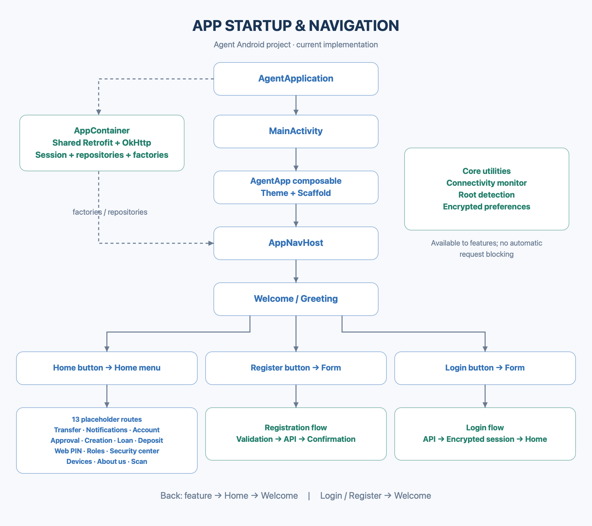
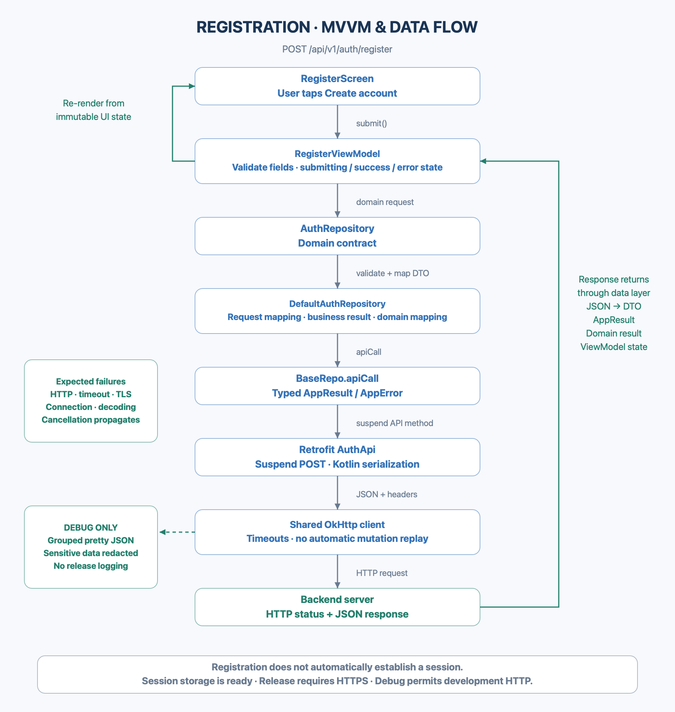
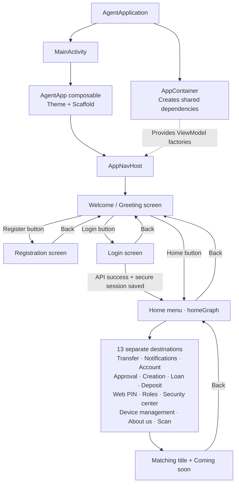
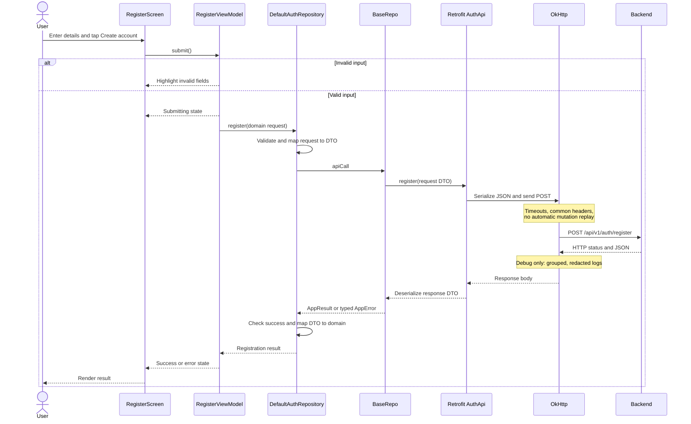
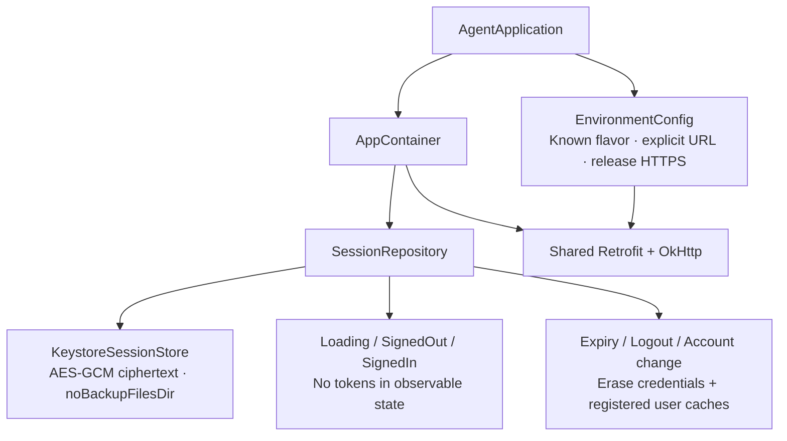

# Current project structure and workflow

## Diagram images

### Startup and navigation



### Registration and data flow



The PNG images display without Mermaid support. The Mermaid diagram sources remain below for reference.

These diagrams describe the current implementation. The application uses Kotlin, Jetpack Compose, MVVM, manual dependency injection, Retrofit, and OkHttp.

## Project structure

```text
app/
├── document/                  Implementation notes and reference code
└── src/
    ├── main/
    │   ├── java/com/daro/agentapp/
    │   │   ├── AgentApplication.kt  Registered Android Application
    │   │   ├── MainActivity.kt
    │   │   ├── app/            Root AgentApp composable and AppContainer
    │   │   ├── navigation/     Destination, AppNavHost, HomeGraph
    │   │   ├── presentation/   Greeting, Home, registration screens/ViewModels
    │   │   ├── domain/         Models, repository interfaces, session lifecycle
    │   │   ├── data/
    │   │   │   ├── local/session/ Keystore-encrypted session store
    │   │   │   ├── remote/     Retrofit, OkHttp, API interfaces, DTOs
    │   │   │   ├── repository/ Repository implementations
    │   │   │   └── mapper/     Request/domain and response/domain conversion
    │   │   ├── base/           Shared BaseRepo transport error mapping
    │   │   ├── core/           Environment policy, results, errors, connectivity, utilities
    │   │   └── ui/             Theme, reusable load states, error components
    │   └── res/               Shared resources
    ├── staging/res/           Environment configuration and images
    ├── uat/res/
    ├── preProd/res/
    ├── prod/res/
    ├── prodDebug/res/         Development-only production-flavor URL override
    ├── debug/                 Pretty JSON logging interceptor and formatter
    ├── release/               Empty logging-interceptor list
    ├── test/                  Shared unit tests
    ├── testDebug/             Debug logging tests
    └── androidTest/           Emulator/device tests
```

Each environment has Debug and Release variants. Shared application code stays in `main`; environment resources override shared resources when names and configurations match. Debug logging applies to all four debug flavors.

## Startup and navigation



`Destination` centralizes route strings. `AppNavHost` owns the navigation controller, and `homeGraph()` registers the Home menu and its feature destinations in the root graph. Screens receive callbacks rather than a navigation controller. The 13 feature destinations are placeholders; they do not implement banking or camera operations.

## Registration request and response flow



`RegisterRoute` collects the ViewModel's read-only state with lifecycle awareness and passes it to `RegisterScreen`. The ViewModel coordinates submission in `viewModelScope` and guards against duplicate submissions. `BaseRepo` maps expected transport failures and propagates cancellation. Feature-specific business checks remain in the repository.

## Shared dependencies and logging

`AppContainer` lazily supplies one Retrofit instance backed by a shared OkHttp connection pool, generated API services, repositories, and ViewModel factories. New features can add services and repositories through this container without creating a client in each repository.

Debug builds install a grouped, sanitized JSON logging interceptor. Release builds do not include the debug interceptor or formatter. To view debug logs in Android Studio Logcat, use:

```text
tag:AgentNetwork
```

Passwords, tokens, personal data, authorization/cookie headers, and unknown scalar values are redacted. Logs show service, method, endpoint template, safe headers, request/response structure, HTTP status, and timing.

## Current boundaries

- Connectivity monitoring, root checks, and encrypted preferences are shared utilities. They do not automatically block API requests.
- Registration shows success and clears the form. It does not persist tokens or automatically log in.
- Production Release uses the supplied HTTPS URL and blocks cleartext. Debug development builds retain the supplied HTTP endpoint. The production TLS handshake is currently failing and needs a backend fix.
- The login endpoint is implemented through AuthRepository.login(LoginRequest), sharing the registration response models and typed error handling. Login has a screen linked below Register; success establishes the session and opens Home. Refresh/revocation endpoints and the Home menu's business features remain to be implemented. Session logout cleanup is already available.
- See [implement.md](implement.md) for implementation details, verification history, and known limitations.

## Session and release foundation

AppContainer owns SessionRepository and restores encrypted credentials asynchronously. Explicit session establishment persists tokens through Android Keystore-backed AES-GCM storage; signed-in UI state contains no credentials. Expiry, logout, and account changes clear credentials and registered user caches. Registration still does not automatically establish a session.



CI definitions under `.github/` cover debug builds/tests/lint, release policy, API 23/35 device tests, and secret scanning after push. See implement.md section 23 for configuration, commands, feature contracts, and validation boundaries.

## Login flow

Welcome → Login button → phone/password form → AuthRepository.login → SessionRepository.establish → Home. API or storage errors stay on the form. Login is popped after success, and passwords are never saved in instance state. Registration remains independent and does not automatically sign in.

Explicit development response inspection uses `DebugJsonLog.d("ResponseData==>") { result.value.toPrettyJson() }`. This separate debug-only path shows actual login response data, including tokens and phone number, at the user's request. Keep these logs private. The normal AgentNetwork interceptor remains redacted, and both log paths are disabled in release.
